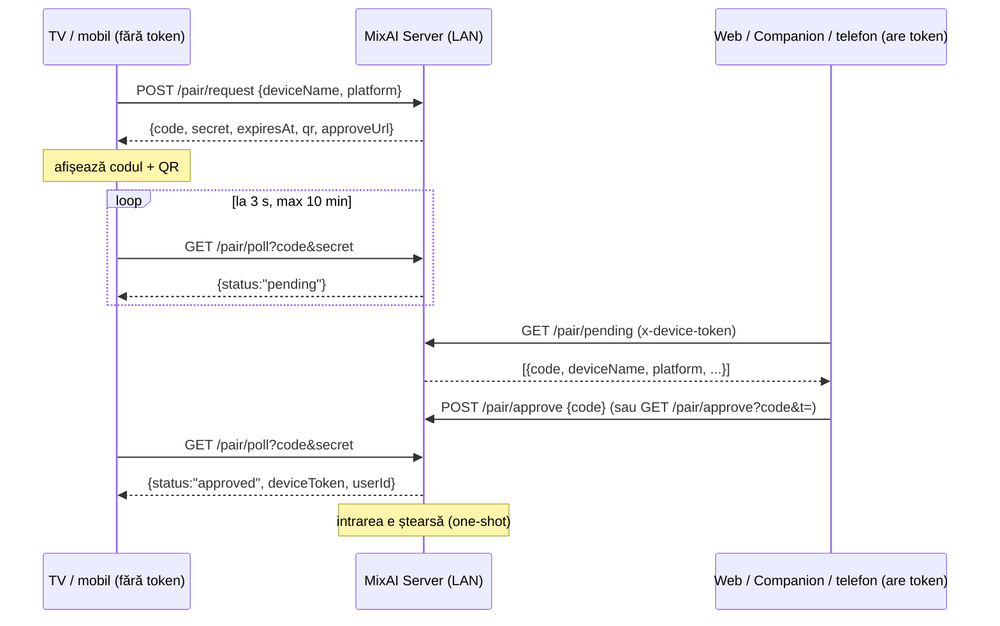

# Quick Connect — împerechere fără tastare (TV / mobil)

Un televizor sau un telefon nu ar trebui să tasteze niciodată un token. În loc de asta,
dispozitivul afișează un **cod de 6 cifre** (și un QR), iar un dispozitiv deja
autentificat îl aprobă. Modelul e identic cu „Quick Connect” din Jellyfin.

Implementare: `server/src/pair/` (montat pe `/pair` în `server/src/server.ts`).
Serverul MixAI (Companion sau headless) este singura autoritate — nu trece prin cloud.

## Flux



1. TV-ul descoperă serverul (mDNS `_mmo-companion._tcp`, TXT `pair=1`, `name=<hostname>`;
   sau `GET /pair/info` pe o adresă cunoscută).
2. Cere un cod: `POST /pair/request`.
3. Afișează codul mare pe ecran + QR-ul `mixai://pair?host=&port=&code=` și
   linkul `approveUrl` (`https://mixai.ro/pair?host=&port=&code=`).
4. Face poll la fiecare 3 secunde.
5. Când primește `approved`, salvează `deviceToken` și `userId` și folosește
   `x-device-token` ca orice alt client.

## Endpoint-uri

| Metodă | Cale | Auth | Corp / query | Răspuns |
|---|---|---|---|---|
| `GET` | `/pair/info` | nu | — | `{name, version, lanUrl, port, pairingSupported:true, hasToken}` |
| `POST` | `/pair/request` | nu | `{deviceName?, platform?}` | `201 {code, secret, expiresAt, qr, approveUrl}`; `503` dacă serverul nu are încă token; `429` peste 20 cereri în așteptare |
| `GET` | `/pair/poll` | nu | `?code=&secret=` | `{status:"pending"}` · `{status:"approved", deviceToken, userId}` · `{status:"expired"}`; `400` cod malformat, `403` secret greșit, `429` poll < 2 s |
| `POST` | `/pair/approve` | `x-device-token` | `{code}` | `{ok:true, code}`; `404` cod necunoscut / expirat |
| `GET` | `/pair/approve` | `?t=<deviceToken>` | `?code=&t=` | idem — pentru telefonul care a scanat QR-ul |
| `POST` | `/pair/deny` | `x-device-token` | `{code}` | `{ok}` |
| `GET` | `/pair/pending` | `x-device-token` | — | `{pending:[{code, deviceName, platform, createdAt, expiresAt, approved}]}` (fără secrete) |

`lanUrl`/`host` folosesc aceeași adresă LAN pe care o calculează `lan-announce.ts`
(`pickLanAddress()`); `approveUrl` pornește de la `store.get("webAppUrl")`
(implicit `https://mixai.ro`).

## Cum aprobi

- **Din web (mixai.ro → Dispozitive)**: pagina citește `/pair/pending` prin
  helper-ul de Companion și afișează „*MixAI TV* vrea să se conecteze — Aprobă”.
  Aprobarea face `POST /pair/approve {code}` cu tokenul dispozitivului curent.
- **De pe telefon, scanând QR-ul**: QR-ul deschide `https://mixai.ro/pair?host=&port=&code=`.
  Web app-ul (telefonul e pe același LAN) apelează
  `GET http://<host>:<port>/pair/approve?code=<code>&t=<deviceToken-ul telefonului>`.
- **Din Companion (desktop)**: același `/pair/pending` + `/pair/approve`, local.
- **Headless (Pi/Docker)**: nu e nevoie de nimic în plus — `headless.ts` generează
  tokenul la prima pornire; orice client care îl deține poate aproba.

Verificare manuală rapidă:

```powershell
curl.exe -s -X POST http://<lan-ip>:17899/pair/request -H "content-type: application/json" -d '{"deviceName":"Test","platform":"cli"}'
curl.exe -s "http://<lan-ip>:17899/pair/poll?code=<code>&secret=<secret>"
curl.exe -s -X POST http://<lan-ip>:17899/pair/approve -H "x-device-token: <token>" -H "content-type: application/json" -d '{"code":"<code>"}'
```

## Securitate

- Codul are 6 cifre (`crypto.randomInt`, uniform), unic printre cererile active;
  `secret`-ul are 32 de octeți aleatori (hex) și leagă poll-ul de cel care a cerut codul —
  cine vede codul pe ecran nu poate face poll în locul TV-ului.
- Expirare **10 minute**; maxim **20 cereri** în așteptare (protecție la flood).
- Compararea secretului și a tokenului din `?t=` e în timp constant (`timingSafeEqual`).
- Aprobarea cere **tokenul real** al serverului (`authMiddleware` sau `?t=`); un
  atacator de pe LAN nu poate aproba propria cerere.
- Poll limitat la unul la 2 s per cod; răspunsul `approved` e livrat **o singură dată**,
  după care intrarea dispare.
- `/pair/pending` nu returnează niciodată `secret`; logurile conțin doar codul,
  numele dispozitivului și platforma — niciodată secrete sau tokenuri.
- Totul e în memorie: un restart al serverului anulează cererile în curs (TV-ul cere
  un cod nou).

## Teste

`server/src/pair/pair.test.ts` (vitest, fără SQLite): format cod, expirare,
approve → poll one-shot, secret greșit → 403, rate limit, variantele HTTP.

```powershell
cd server; pnpm exec tsc --noEmit
# Node 22 pe PATH (fnm), apoi:
node node_modules\vitest\vitest.mjs run src/pair
```

## Partea web (`apps/web`)

| Fișier | Rol |
|---|---|
| `src/app/pair/page.tsx` | Rută protejată. Fără sesiune → `/api/auth/signin?callbackUrl=/pair?host=…&port=…&code=…` (revine cu parametrii intacți). |
| `src/app/pair/pair-client.tsx` | UI mobile-first: card „Aprobi MixAI TV pe {server}?”, input de 6 cifre (`inputMode=numeric`, `autocomplete=one-time-code`), buton mare **Aprobă**, stare de succes „Conectat — poți lăsa telefonul jos”. Câmpul *host* apare doar când QR-ul nu l-a furnizat. |
| `src/app/pair/pending-pairings-panel.tsx` | Panou pe pagina **Devices**: listează cererile în așteptare de pe toate companion-urile online (polling 5 s cât timp tab-ul e vizibil), buton Aprobă pe rând. Se ascunde când nu e nimic. |
| `src/actions/pair.ts` | Server actions: `approvePairing({host, port?, code})`, `approvePairingOnDevice({deviceId, code})`, `listPendingPairings()`. Zod + sesiune obligatorie. |
| `src/lib/companion-pair.ts` | Client HTTP (`X-Device-Token`) pentru `/pair/pending` (acceptă `pending` sau `requests`), `/pair/approve`, `/pair/info` + helper-ele pure `matchCompanionByHost`, `urlHost`, `urlPort`. Fără `server-only`, testabil cu `fetch` mock (`companion-pair.test.ts`). |
| `messages/{ro,en}.json` → `pair.*` | Toate textele. |

Web-ul aprobă **server-side** (tokenul dispozitivului nu ajunge niciodată în browser), deci
folosește `POST /pair/approve` cu `x-device-token`, nu varianta `GET ?t=`.

### Cum alegem companion-ul (`matchCompanionByHost`)

1. dispozitivele utilizatorului al căror `lanUrl` **sau** `apiUrl` are același hostname
  (case-insensitive) cu `host` din QR;
2. dacă mai multe → portul din QR e tiebreaker, altfel primul;
3. dacă niciunul, dar utilizatorul are **exact un** companion → acela;
4. altfel `not_found`.

URL-ul efectiv pentru apel vine din `pickCompanionUrl` (local: loopback > LAN > tunnel;
pe Vercel: tunnel > LAN ne-loopback), deci de pe cloud aprobarea merge prin
`https://device-<slug>.mixai.ro`.

### Erori tipizate

`not_found` (404) · `unauthorized` (401/403) · `expired` (410 sau mesaj „expired”) ·
`unreachable` (fetch eșuat / timeout 10 s) · `failed` · `unauthenticated` · `invalid` (Zod).
Fiecare are text în `pair.errors.*` (RO + EN).

```powershell
cd apps/web; pnpm exec tsc --noEmit
pnpm exec eslint src/app/pair src/actions/pair.ts src/lib/companion-pair.ts
pnpm exec vitest run src/lib/companion-pair.test.ts
```

## Autentificare cu contul MixAI de pe TV (device code)

Quick Connect (mai sus) leagă TV-ul de **un MMO Server** din LAN. Device-code login
leagă TV-ul de **contul MixAI** (mixai.ro), ca la Plex/Netflix: TV-ul afișează un cod,
telefonul îl aprobă, TV-ul primește o sesiune Auth.js + lista companion-urilor (cu
token) ale utilizatorului. Forma urmează RFC 8628 (OAuth Device Authorization Grant).

### Flux

1. TV → `POST /api/device/code` `{ deviceName, platform, appVersion? }` (fără auth,
   rate-limit 10/min per IP). Răspuns:
   `{ device_code, user_code: "ABCD-2345", verification_uri: "https://mixai.ro/activate",
   verification_uri_complete: "https://mixai.ro/activate?code=ABCD2345", expires_in: 900, interval: 5 }`.
   TV-ul afișează `user_code` (și, opțional, un QR cu `verification_uri_complete`).
2. Telefon → `/activate?code=ABCD2345` (sau introduce codul manual). Fără sesiune →
   `/login?callbackUrl=/activate?code=…`. Pagina arată „Conectezi \<deviceName\> (\<platform\>)?” cu
   butoane **Aprobă / Refuză** (server actions `approveDeviceCode` / `denyDeviceCode`, Zod →
   sesiune → update doar dacă rândul e `pending` și neexpirat).
3. TV → `POST /api/device/token` `{ device_code }` la fiecare `interval` secunde:
   - `428 { error: "authorization_pending" }` — încă neaprobat;
   - `403 { error: "slow_down" }` — poll mai des decât `interval - 1 s`;
   - `403 { error: "access_denied" }` — refuzat de utilizator;
   - `410 { error: "expired_token" }` — expirat (15 min) sau deja consumat;
   - `200 { session_token, expires, user: { id, name, image }, companions: [{ id, name, lanUrl, apiUrl, tunnelHostname, token }] }`.

   `session_token` este un rând real în tabela Auth.js `session` (30 zile), creat exact ca în
   `/api/auth/desktop-bootstrap`; TV-ul îl trimite ca cookie `authjs.session-token`
   (`__Secure-authjs.session-token` pe HTTPS) către mixai.ro. `companions[].token` este
   token-ul de device (`X-Device-Token`) pentru MMO Server-ele utilizatorului.

### Stocare

Tabela `device_auth_codes` (`packages/db/src/schema.ts`, migrația
`apps/web/drizzle/0029_device_auth_codes.sql`): `device_code_hash` (sha256, unic),
`user_code` (8 caractere din alfabetul fără 0/O/1/I, fără cratimă, unic), `device_name`,
`platform`, `ip`, `user_id`, `status` (`pending | approved | denied | consumed | expired`),
`last_polled_at`, `expires_at`. Logica pură (alfabet, normalizare, mașina de stări) e în
`apps/web/src/lib/device-code.ts`, testată în `device-code.test.ts`.

### Securitate

- `device_code` (32 bytes aleatori) nu se stochează în clar, doar hash-ul.
- `user_code` are 40 biți de entropie și 15 minute de viață; aprobarea cere sesiune.
- Consumarea e atomică (`UPDATE … WHERE status='approved'`), un singur poller câștigă.
- Sesiunea emisă nu ridică privilegii peste ce are utilizatorul care a aprobat.

```powershell
cd apps/web; pnpm exec tsc --noEmit
pnpm exec eslint src/app/activate src/actions/device-code.ts src/lib/device-code.ts src/app/api/device
pnpm exec vitest run src/lib/device-code.test.ts
```
