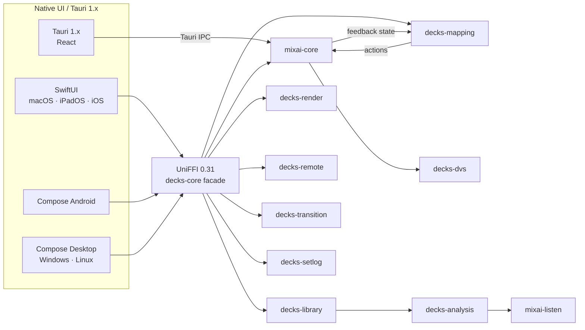
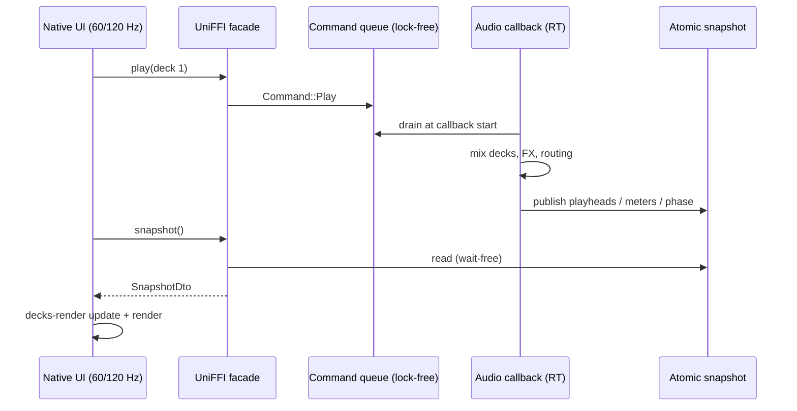
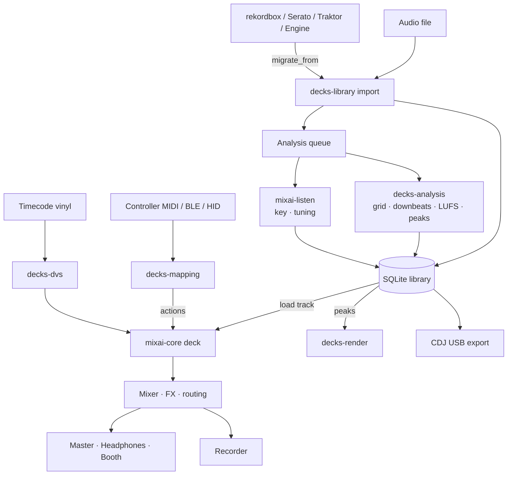

# MixAI Decks — architecture

Status 2026-11-09. Decision record: [ADR-0014](../adr/0014-mixai-decks-native-dj.md); decisions D60–D68 and work
packages WP19-xx in [`docs/mixai-design-tracker.md`](../mixai-design-tracker.md) §13. History of the Tauri 1.x plan:
[`docs/mixai/00-architecture-and-plan.md`](../mixai/00-architecture-and-plan.md).

## 1. Crate map

All Decks crates live in the Cargo workspace `apps/mixai/src-tauri` (`members = [".", "crates/*"]`, edition 2024,
MSRV 1.87, `publish = false`). Key detection is shared with MixAI Key & BPM through `crates/mixai-listen` at the repo
root (path dependency).

| Crate | Path | Responsibility | Licence |
|---|---|---|---|
| `mixai` | `apps/mixai/src-tauri` | Tauri 1.x app shell: IPC commands, MIDI/HID glue, React UI bridge | AGPL-3.0-or-later (only exception in `deny.toml`) |
| `mixai-core` | `crates/mixai-core` | Real-time engine: cpal 0.18 output, symphonia 0.6 decode, decks, mixer, sync / quantize / slip / key shift, routing matrix (master, headphone cue, booth), Signalsmith stretcher (WSOLA fallback), colour + beat FX, sampler, recorder | MIT OR Apache-2.0 |
| `decks-analysis` | `crates/decks-analysis` | Offline analysis: tempo, beatgrid + downbeats, drift anchors, EBU R128 LUFS + true peak, 3-band waveform peaks; key via `mixai-listen` | MIT OR Apache-2.0 |
| `mixai-listen` | `crates/mixai-listen` (repo root) | Key (CNN + chroma), tuning, live listening; shared with Key & BPM (WP18) | MIT OR Apache-2.0 |
| `decks-library` | `crates/decks-library` | SQLite catalogue (WAL, FTS5): tracks, cues, grids, crates, smart crates, history; interop (rekordbox XML / PDB, NML, Serato, Engine DJ, JSON); CDJ USB export — see [library-interop.md](library-interop.md) | MIT OR Apache-2.0 |
| `decks-mapping` | `crates/decks-mapping` | Controller runtime: mapping format v1 + JSON Schema, rhai sandbox scripts, MIDI learn, MIDI clock master/follower, groove lane, BLE MIDI codec, built-in profiles — see [mapping-format.md](mapping-format.md), [controllers.md](controllers.md) | MIT OR Apache-2.0 |
| `decks-dvs` | `crates/decks-dvs` | Clean-room DVS decoder: MixAI timecode (absolute + relative), Serato CV02.5 / Traktor MK2 relative (experimental) — see [dvs.md](dvs.md), [dvs-clean-room.md](dvs-clean-room.md) | MIT OR Apache-2.0 |
| `decks-render` | `crates/decks-render` | wgpu 30 GPU views: scrolling 3-band waveform + beatgrid, overview, stacked decks, platter, DVS scope; native surface or headless | MIT OR Apache-2.0 |
| `decks-stems` | `crates/decks-stems` | On-device stem separation (HT-Demucs ONNX via ort, load-dynamic), stem cache shared with the MMO Server — see [stems.md](stems.md) | MIT OR Apache-2.0 |
| `decks-remote` | `crates/decks-remote` | Connected mode: LAN HTTP + WebSocket server, phone remote / second screen / Party DJ requests, QR pairing — see [remote.md](remote.md) | MIT OR Apache-2.0 |
| `decks-transition` | `crates/decks-transition` | AI Transition Designer: next-track ranking, phrase-aligned transition plans as editable automation, runner, 32-bar safety, RO/EN intents, in-key risers — see [transitions.md](transitions.md) | MIT OR Apache-2.0 |
| `decks-setlog` | `crates/decks-setlog` | Set recording tracklist: audibility-based detection, CUE with ISRC, ORDA / UCMR-ADA CSV, Mixcloud sections, M3U8 — see [set-recording.md](set-recording.md) | MIT OR Apache-2.0 |
| `decks-ffi` | `crates/decks-ffi` | UniFFI surface for Swift and Kotlin over all of the above — see [ffi.md](ffi.md) | MIT OR Apache-2.0 |

Planned (WP19-04): a `decks-core` facade with a stable command/event API and the UniFFI 0.31 surface for Swift and
Kotlin. The binding layer is specified in [ffi.md](ffi.md).

## 2. Threading model

| Thread | Owner | Rules |
|---|---|---|
| **Audio callback** (cpal; WASAPI / CoreAudio / ALSA·JACK / AAudio) | `mixai-core` `Mixer`, moved into the callback | Realtime priority (WP19-03). No locks, no allocation, no I/O, no logging, no syscalls that can block. Commands arrive through a lock-free `crossbeam` channel and are drained at the top of each callback; the DVS decoder runs here (`DvsDecoder::process` allocates nothing, proved by `tests/no_alloc.rs`). Budget: < 25 % of the buffer period. |
| **Decode / read-ahead** | `mixai-core` deck loaders | Decodes with symphonia into pre-allocated ring buffers ahead of the playhead; never blocks the callback (underrun = silence + xrun counter). |
| **Analysis workers** (background, low priority) | `decks-analysis`, `mixai-listen`, stems (WP19-09) | One job per track, results written to the `decks-library` analysis cache, then pushed to the engine as a command (beatgrid, key, gain). |
| **MIDI / HID input** | `decks-mapping` transport callbacks | Timestamped bytes (µs) → `MappingEngine::on_midi` → actions → engine commands. Clock follower and groove lane are timestamp-driven (no own threads). rhai scripts are capped at 100 000 operations / 5 ms per call. |
| **UI / render** | native UI + `decks-render` | Polls an atomic snapshot (transport, meters, playheads, phase) at display rate; never calls into the realtime state. Peaks upload once per track (`Renderer::set_peaks`), per-frame `Renderer::update(&FrameState)` + `render()` allocate nothing. |
| **Library** | `decks-library` | SQLite in WAL mode on its own connection; imports/migrations run off the UI thread and report progress. |

UI → engine is commands only; engine → UI is a polled snapshot (no callbacks across UniFFI on the hot path; events
such as "track loaded" or "analysis finished" use a bounded event queue drained by the UI).

## 3. Data flow

## 4. Native UI plan (Decks 2.0)

| Platform | UI | Audio | MIDI | GPU surface for `decks-render` |
|---|---|---|---|---|
| macOS, iPadOS, iOS | SwiftUI multiplatform target in `apps/ios` (XcodeGen), Swift bindings (WP19-15) | cpal → CoreAudio, `AVAudioSession` on iOS | CoreMIDI (BLE via `CABTMIDICentralViewController`) | `CAMetalLayer` in an `NSView`/`UIView` representable (Metal) |
| Android phone / tablet / ChromeOS | Jetpack Compose in the `apps/tv-android` Gradle build, `ro.mixai.dj` (WP19-16) | cpal → AAudio; latency class badge (`android.hardware.audio.pro`) | `android.media.midi` / AMidi, BLE via `MidiManager.openBluetoothDevice` | `SurfaceView` → `ANativeWindow` (Vulkan, GLES fallback) |
| Windows, Linux | Compose Multiplatform Desktop sharing view models and most composables with Android, Kotlin bindings over JNA (WP19-17) | cpal → WASAPI / ALSA·JACK·PipeWire | midir (WinRT / Windows MIDI Services, ALSA) | child HWND (DX12 / Vulkan), X11 / Wayland handle (Vulkan) |

Only the chrome is native; waveforms, overview, platters and the DVS scope are drawn once in Rust. Text labels are
overlaid by the native UI. Skins are design-token surface presets plus a JSON layout (WP19-18).

## 5. Decks 1.x → 2.0 transition (D62)

- **1.x** = the current Tauri app (`apps/mixai`, React UI over Tauri IPC, same `mixai-core`), shipped on Windows
  (MSIX, Store record `9P5P2WN26RMS`), macOS (notarised DMG + Mac App Store) and Linux (AppImage / deb / Flathub) by
  `decks-release.yml` (WP19-02).
- New engine features land in the crates first and are exposed to 1.x through Tauri commands, so 1.x users get
  them before 2.0.
- **2.0** replaces 1.x **in place** in the same store listings and with the same application id `ro.mixai.dj`;
  library (SQLite), mappings (JSON) and settings are crate-owned, so they carry over unchanged.
- The React UI in `apps/mixai/src` is frozen for new surfaces once 2.0 reaches parity and is deleted after the last
  1.x release.

## 6. Licence policy

- Decks crates are **MIT OR Apache-2.0**; only the Tauri app crate `mixai` is AGPL-3.0-or-later
  ([ADR-0007](../adr/0007-licensing-agpl-core-mit-sdk.md)) and nothing depends on it.
- `apps/mixai/src-tauri/deny.toml` (cargo-deny config v2) allows permissive licences only, so every GPL / AGPL /
  LGPL form is rejected; explicit bans: `rubberband(-sys)`, `essentia(-sys)`, `aubio(-rs/-sys)` and the other
  entries listed there. Also out by policy: xwax and Mixxx code or mappings, Ableton Link (GPL), libKeyFinder.
- Run locally from `apps/mixai/src-tauri`: `cargo deny --workspace --all-features check licenses bans sources`
  (cargo-deny 0.20 reads the `deny.toml` next to the manifest; without `--workspace` crates the app does not yet
  depend on are skipped silently).
- Clean-room rule for DVS: [dvs-clean-room.md](dvs-clean-room.md). Mapping data only from manufacturers' published
  MIDI documents: [mapping-format.md](mapping-format.md).

## 7. Test and CI

| Workflow | Trigger | Jobs |
|---|---|---|
| `.github/workflows/decks-ci.yml` | push to `main` / PR touching `apps/mixai/**` or the workflow | `frontend` (typecheck + Vite build of the 1.x UI); `rust` matrix (`${{ matrix.os }}`): `cargo fmt --check -p` Decks crates (the shared `crates/mixai-listen` is formatted by its own workspace), `cargo clippy --workspace --all-targets --all-features -D warnings`, `cargo test --workspace --all-features`; `licences` (cargo-deny `--workspace --all-features check licenses bans sources`) |
| `.github/workflows/decks-release.yml` | tag `decks-v*` / manual dispatch | preflight (tag = `tauri.conf.json` = `package.json` version) → create-release → build matrix (MSIX, DMG, AppImage / deb) for Decks 1.x |

Test layers: unit tests per crate (DSP fixtures, interop round-trips, mapping profiles against the published MIDI
lists, DVS synthetic carriers at 30 dB SNR), no-allocation tests (`decks-dvs`, `decks-render`), JSON Schema bless
test for the mapping format, headless wgpu snapshot tests, release-profile perf runs.

## 8. Performance budgets

| Budget | Target | Measured |
|---|---|---|
| Audio callback | < 25 % of buffer time (e.g. < 1.33 ms at 256 frames / 48 kHz) | xrun counter + callback timing exported in metrics (WP19-03) |
| 120 Hz render | p99 frame < 8.3 ms | **5.6 ms** p99 on RTX 3060 Ti (`decks-render` bench) |
| Analysis of a 3-min track | < 3 s | **0.88 s** (180 s stereo, release profile, fat LTO) |
| DVS speed estimate | < 0.1 % error | 0.03–0.08 % at 30 dB SNR (8 ms window) |
| MIDI clock out | ± 0.1 ms per tick | within 0.1 ms of ideal at 128 BPM |

## 9. Pro infra (WP19-23, prepared, not enabled)

ADR-0014 decision 10: Decks is free at launch; Pro infrastructure exists but is off.

- **Entitlement:** `decks_pro` in `apps/web/src/lib/entitlements.ts`, granted when the feature flag
  `MIXAI_FLAG_DECKS_PRO` is `1`/`true` (**unset = off**) **and** the user's subscription is Pro on plan
  `pro_monthly` or `pro_yearly` (`getSubscription` in `apps/web/src/lib/stripe.ts`, which already honours the
  `past_due` grace period). Unit tests in `entitlements.test.ts`.
- **Storage:** none new. Definitions live in code; billing state is the existing `subscriptions` table kept in sync
  by the Stripe webhook. No DB migration.
- **Not exposed:** no UI, no route and no API field returns entitlements today.
- **When enabled (later work):** the MixAI account API returns `entitlementsFor(sub)`; the native apps receive it
  with the signed-in session, cache it with an expiry (offline grace) and gate Pro features in the UI layer only —
  the Rust core stays licence-agnostic. A Decks-only price would add a Stripe price id and a plan value, which needs
  the `subscriptions.plan` values extended (a migration only if the column is constrained); App Store / Play
  purchases would map to the same entitlement server-side.
