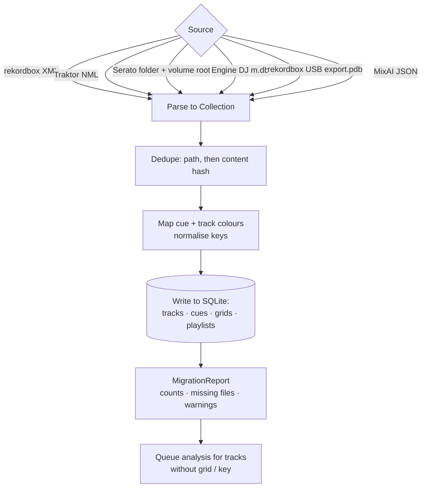

# MixAI Decks — library interop

Crate `apps/mixai/src-tauri/crates/decks-library` (WP19-11). Every format converts to and from one neutral model
(`model::Collection`: tracks, cues with colours, beat grids, playlists); the SQLite library is the only persistent
store. Architecture context: [architecture.md](architecture.md).

## Read / write matrix

| Format | Read | Write | What is carried | Module |
|---|---|---|---|---|
| rekordbox XML (*Export Collection in xml format*) | yes | yes | tracks, tags, BPM, key, rating, colour, memory + hot cues with colours, loops, beat grid (`TEMPO`), playlist tree | `interop/rekordbox.rs` |
| Traktor NML (`collection.nml`, playlist exports) | yes | yes | tracks, `MUSICAL_KEY`, `INFO COLOR` (1–7), `CUE_V2` (cue / fade / load / loop / grid), playlists | `interop/nml.rs` |
| Serato `_Serato_/Subcrates/*.crate` | yes | yes | crates (nested via `%%`), track paths relative to the volume root | `interop/serato.rs` |
| Serato `Serato Markers2` (GEOB tag) | yes | frame payload bytes | cues, loops, colours, BPM lock; unknown entries (`FLIP`, …) kept for lossless rewrite | `interop/serato.rs` |
| Engine DJ `Engine Library/Database2/m.db` (2.x–4.x) | yes | no | tracks, key, rating, quick cues, loops, beat grid from `PerformanceData` (Qt `qCompress` blobs), playlists in linked-list order | `interop/engine.rs` |
| rekordbox device export `PIONEER/rekordbox/export.pdb` | yes (tracks + playlists) | no | tracks with tags, key, BPM, colour, play count, path; playlist tree. Not read: cues, grids, waveforms (`USBANLZ/*.DAT|EXT`) | `interop/pdb.rs` (native reader) |
| Neutral JSON | yes | yes | the full `Collection` | `interop/json.rs` |
| OneLibrary | pending | pending | no public specification as of 2026-11-08 (see [streaming.md](streaming.md#onelibrary)) | `interop/mod.rs` slot |
| CDJ USB export | — | XML + folder layout | `Contents/<Artist>/<Album>/`, `PIONEER/` marker, `rekordbox.xml`, optional Serato crates. **No `export.pdb`** | `cdj.rs` |

Not supported: Engine 1.x (`m.db` + `p.db`), VirtualDJ `database.xml` (not yet), writing Engine DB or PDB.

Why no PDB writer: there is no permissively licensed DeviceSQL writer (rekordcrate 0.3, MPL-2.0, keeps its `Track`
fields private and its `Page` type is not writable), and OneLibrary is unpublished. For players that only read
`export.pdb`, import the exported `rekordbox.xml` into rekordbox and use *Export to device*.

## Migration flow

`migrate::migrate_from(&mut library, Source::…)` is the one call behind *Import from another DJ app*:

- Files that do not exist on this machine are imported anyway and flagged in `MigrationReport` for relocation.
- For Serato, cues, colours and BPM lock are read from each file's `Serato Markers2` tag when the file is present.
- Existing analysis is kept; MixAI analysis (`decks-analysis` + `mixai-listen`) runs only where grid or key is
  missing, or on user request.
- The FLX4 controller layout preference follows the import source (Serato import → Serato layout), see
  [controllers.md](controllers.md#alege-layout-ul-rekordbox-sau-serato).

## Key notation mapping

`keys.rs` stores a key as pitch class + mode and converts between notations:

| Notation | Example (A minor / C major) | Used by |
|---|---|---|
| Camelot | `8A` / `8B` | MixAI UI default, Mixed In Key |
| Open Key | `1m` / `1d` | Traktor display |
| Musical text | `Am` / `C` | rekordbox XML `Tonality`, Serato |
| Traktor integer | 21 / 0 (0–11 major from C, 12–23 minor from Cm) | NML `MUSICAL_KEY VALUE` |
| Engine integer | walks the Camelot wheel from 8B: even = major, odd = minor (0 = C, 1 = Am, 2 = G, 3 = Em, …) | Engine DJ `Track.key` (assumption from public exports) |

`MusicalKey::parse` accepts Camelot, Open Key and musical text (`F# minor`, `Db`).

## Colour mapping

`colour.rs` holds each application's palette and maps by nearest perceptual ("redmean") distance:

- **rekordbox**: exact RGB for cues; 16-colour hot cue palette (rekordbox 6/7, CDJ-3000 order); 8 track colours.
- **Serato**: exact RGB in `Markers2`; its own cue palette.
- **Traktor**: indexed track colour (`INFO COLOR` 1–7); cue colour fixed per cue type (cue, fade-in, fade-out, load,
  loop) — a custom cue colour cannot survive an export to NML.
- Exports call `map_cue_colour` / `map_track_colour` with the target platform, so a colour always lands on a value the
  target can display. Palette values come from public exports; treat them as close approximations.

## Related

- Neutral library schema and FTS search: `decks-library/src/schema.rs`.
- The web app has its own rekordbox XML / Serato crate writers (`apps/web/src/lib/serato-crate.ts`); the Rust Serato
  writer mirrors that format.
