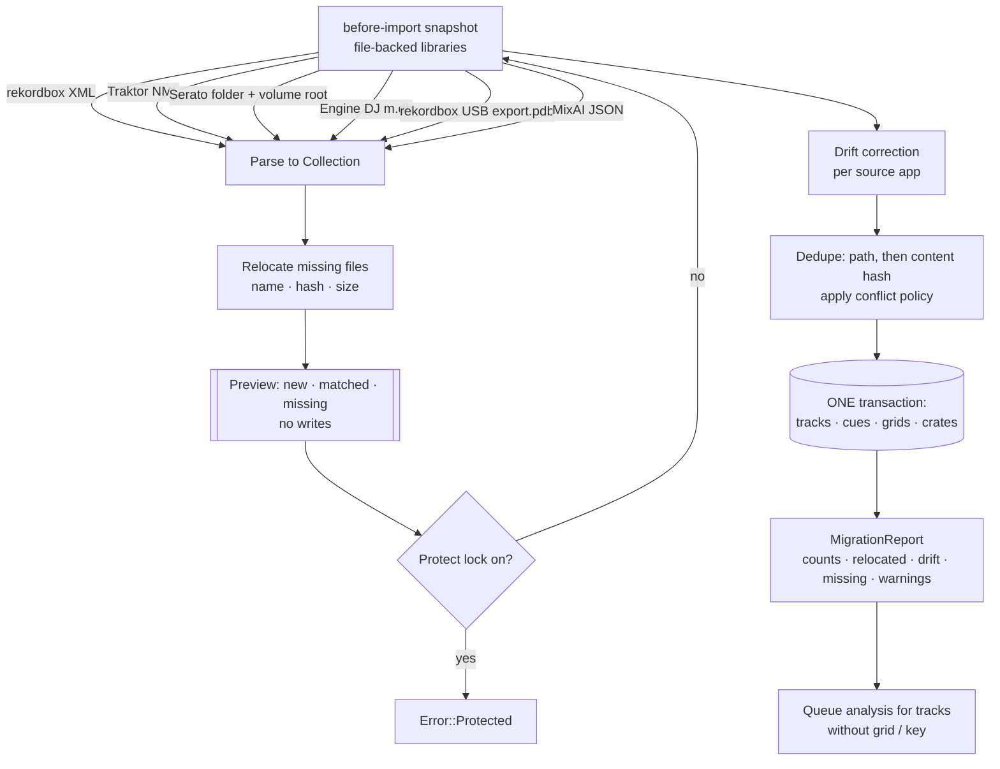

# MixAI Decks — library interop

Crate `apps/mixai/src-tauri/crates/decks-library` (WP19-11). Every format converts to and from one neutral model
(`model::Collection`: tracks, cues with colours, beat grids, playlists); the SQLite library is the only persistent
store. Architecture context: [architecture.md](architecture.md).

**Positioning (WP19-38):** bring your rekordbox, Serato or Traktor library with its cues, grids and playlists in one
step, and play it on your controller. **No subscription to unlock hardware**: controller support, import and export
are part of the app, not a paid tier (rekordbox 7 locks hardware features and cloud functions behind its plans).

Where it runs: the native apps (Android + Desktop on Compose, iOS / iPadOS / macOS on SwiftUI), which own a local
library. The Tauri DJ app has no local library and does not offer import.

## Read / write matrix

| Format | Read | Write | What is carried | Module |
|---|---|---|---|---|
| rekordbox XML (*Export Collection in xml format*) | yes | yes | tracks, tags, BPM, key, rating, colour, memory + hot cues with colours, loops, beat grid (`TEMPO`), playlist tree | `interop/rekordbox.rs` |
| Traktor NML (`collection.nml`, playlist exports) | yes | yes | tracks, `MUSICAL_KEY`, `INFO COLOR` (1–7), `CUE_V2` (cue / fade / load / loop / grid), playlists | `interop/nml.rs` |
| Serato `_Serato_/database V2` + `Subcrates/*.crate` | yes | crates only | full collection with tags from `database V2` (tracks in no crate included), crates (nested via `%%`), track paths relative to the volume root | `interop/serato.rs` |
| Serato `Serato Markers2` (MP3 / AIFF GEOB tag, FLAC `SERATO_MARKERS_V2`) | yes | frame payload bytes | cues, loops, colours, BPM lock; unknown entries (`FLIP`, …) kept for lossless rewrite | `interop/serato.rs` |
| Engine DJ `Engine Library/Database2/m.db` (2.x–4.x) | yes | no | tracks, key, rating, quick cues, loops, beat grid from `PerformanceData` (Qt `qCompress` blobs), playlists in linked-list order | `interop/engine.rs` |
| rekordbox device export `PIONEER/rekordbox/export.pdb` | yes (tracks + playlists) | no | tracks with tags, key, BPM, colour, play count, path; playlist tree. Not read: cues, grids, waveforms (`USBANLZ/*.DAT|EXT`) | `interop/pdb.rs` (native reader) |
| Neutral JSON | yes | yes | the full `Collection` | `interop/json.rs` |
| OneLibrary | blocked | blocked | no public specification and no AlphaTheta partner access as of 2026-11-09 (see [streaming.md](streaming.md#onelibrary)) | `interop/mod.rs` slot |
| CDJ USB export | — | XML + folder layout | `Contents/<Artist>/<Album>/`, `PIONEER/` marker, `rekordbox.xml`, optional Serato crates. **No `export.pdb`** | `cdj.rs` |

Not supported: Engine 1.x (`m.db` + `p.db`), VirtualDJ `database.xml` (not yet), writing Engine DB or PDB.

Why no PDB writer: there is no permissively licensed DeviceSQL writer (rekordcrate 0.3, MPL-2.0, keeps its `Track`
fields private and its `Page` type is not writable), and OneLibrary is unpublished. For players that only read
`export.pdb`, import the exported `rekordbox.xml` into rekordbox and use *Export to device*.

## Import flow (WP19-38)

*Import from another DJ app* is three calls, in `decks-library` (`migrate.rs`) and over FFI (`decks-ffi/src/interop.rs`):

| Step | Rust | FFI (Kotlin / Swift) | Writes? |
|---|---|---|---|
| Detect the format of a picked file / folder | `migrate::detect_source(path)` | `detect_import_format(path)` → `DetectedImport { format, path }` | no |
| Preview | `migrate::preview(&lib, &source, &opts)` → `ImportPreview` | `import_preview(library, format, path, options)` → `ImportPreviewRecord` | no |
| Import | `migrate::migrate_with(&mut lib, source, &opts)` → `MigrationReport` | `import_run(library, format, path, options)` → `ImportRunReport` (snapshots first) | yes, in one transaction |

`migrate_from(&mut lib, source)` stays as the one-call form (default options) for existing callers.

Detection: a `.xml` whose first 4 KiB contain `DJ_PLAYLISTS` = rekordbox XML; `.nml` = Traktor; a `_Serato_` folder,
a drive or folder that contains one, or its `database V2` = Serato (volume root = `/Volumes/<name>` on macOS external
drives, otherwise the drive root); `export.pdb` or a USB root with `PIONEER/rekordbox/export.pdb` = rekordbox device
library; `m.db` = Engine DJ; a `mixai-decks-library` JSON = MixAI.

**Preview** (`ImportPreview`): tracks seen, new, matched by path, matched by content hash, missing files, files found
in the relocation folders, cues, grids, playlists, playlist entries, the first 50 missing paths, warnings, and whether
the library is locked. It parses and hashes but writes nothing; it is re-run when the relocation folders change.

**Options** (`MigrateOptions` / FFI `ImportOptions`):

| Option | Values | Effect |
|---|---|---|
| `conflict` | `KeepExisting` | The library wins: imported values only fill empty fields; existing cues and grid stay |
| | `PreferImported` (default, old behaviour) | Non-empty imported fields overwrite; imported cues / grid replace the existing ones when the import has any |
| | `Merge` | Library metadata wins and gaps are filled; imported cues are added unless an existing cue takes the same hot-cue slot or sits within 5 ms; the existing grid stays |
| `relocate_roots` | folders | A file missing at its recorded path is searched by file name under these folders, narrowed by content hash (when known), else by the recorded size (rekordbox `Size` exact, Traktor `FILESIZE` ±1 KiB), else by the most matching parent folder names. Several equal candidates = not relocated, with a warning. Playlists keep pointing at the relocated track |
| `correct_drift` | bool | Calls `drift::correct_record(&mut rec, SourceApp)` per present track (MP3 decoder priming differs between apps, WP19-37); fixes are counted in `drift_fixes` + `drift_notes` |

**Crates follow the same conflict policy** (review P1-6). A source playlist is matched to an existing crate by
name under the same folder:

| Policy | An existing crate with that name | Counted in `playlist_entries` |
|---|---|---|
| `PreferImported` (default) | **replaced**: the crate becomes exactly the source playlist, in the source order — the import wins, as it does for cues and grids | every entry of the playlist |
| `Merge`, `KeepExisting` | **kept**: the tracks it does not already hold are appended at the end, in source order; nothing is removed or reordered | only the appended entries |

Two playlists with the same name in the same folder of one source do **not** collapse into one crate: the second
becomes `name (2)`, the third `name (3)`, and so on (the same name under a different folder is a different crate
and keeps its name). More than `migrate::MAX_SAME_NAME_PLAYLISTS` (64) same-named playlists in one folder means a
malformed source: the import fails (and rolls back, see below). A crate created by a previous import is an
existing crate like any other, so re-running an import under `Merge` adds nothing new for uniquely named
playlists (a repeated duplicate name gets the next free `name (N)` again).

**One transaction** (review P1-6): tracks, cues, grids, crates and crate memberships of an import are written
inside a single SQLite transaction. A failure anywhere — a bad row half way through, a disk error, a crate
constraint — rolls the whole import back and leaves the library exactly as it was; there is no partial import.
The read / relocate / hash phase happens before the transaction opens, so the write itself is short.

**Snapshot before every import** (WP19-40, review P0-1): `import_file`, `migrate_from` **and `import_run`** take a
`before-import` / `before-migrate` snapshot into `<db dir>/snapshots` before writing, so the DJ can roll an import
back from *Library safety* even under the default `PreferImported` policy. In-memory libraries have no snapshot
folder and skip it; a protected library is refused before any snapshot is taken. The Rust `migrate::migrate_with`
does not snapshot by itself — the snapshot belongs to the owner of the library file (the FFI `DecksLibrary`).

**Protect lock** (WP19-40): `migrate_with` calls `Library::is_protected()` before anything is written and returns
`Error::Protected` (FFI `DecksError::Protected { reason }`) when the lock is on; the preview reports `protected: true`
so the UI disables *Import* and says why.

**Report** (`MigrationReport` / FFI `ImportRunReport`): inserted, merged by path / hash, cues and grids written
(under `Merge`, only the added cues count), playlists and entries (under `Merge` / `KeepExisting`, only the entries
actually appended to a crate), files still missing (imported anyway and flagged), relocated, drift fixes, warnings
(Markers2 errors, ambiguous relocations, playlist entries not in the collection).

UI: Compose `ImportPanel` + `ImportState` (`apps/decks-android/ui/.../screens/ImportPanel.kt`, port `ImportPort` /
`FfiImport`), SwiftUI `ImportView` (`apps/ios/DecksApp/Library/ImportView.swift`, sheet with `fileImporter`). Both:
source (auto / rekordbox / Serato / Traktor) → pick → preview → conflict policy, drift toggle, relocation folders →
import → report.

- Files that do not exist on this machine are imported anyway and flagged in `MigrationReport` for relocation.
- For Serato, cues, colours and BPM lock are read from each file's `Serato Markers2` data when the file is present;
  tracks without a title (crates carry only paths) get their tags from the file.
- Existing analysis is kept; MixAI analysis (`decks-analysis` + `mixai-listen`) runs only where grid or key is
  missing, or on user request.
- The FLX4 controller layout preference follows the import source (Serato import → Serato layout), see
  [controllers.md](controllers.md#alege-layout-ul-rekordbox-sau-serato).

## Real-export quirks handled

Each has a fixture or a synthetic test in `decks-library/tests/interop.rs` (`*_quirks_*`) and `tests/migrate.rs`.

| Format | Quirk | Handling |
|---|---|---|
| rekordbox XML | `file://localhost/C:/…` (Windows), `file://localhost/Users/…` (macOS), `file:///E:/…`, `file://NAS/share/…` (UNC), lower- or upper-case percent escapes, back slashes | all decode to one path form; UNC round-trips as `//host/share/…` (`fixtures/rekordbox-quirks.xml`) |
| rekordbox XML | `TEMPO` rows unsorted, with zero BPM, or hundreds of rows repeating one constant tempo (dynamic analysis) | sorted, zero rows dropped, an anchor kept only where tempo or beat phase changes |
| rekordbox XML | `POSITION_MARK` colours outside 0–255, memory loops (`Type 4`, `Num -1`), loops with no `End` or `End ≤ Start`, fade / load marks (Types 1–3), negative starts, exact duplicates | clamped; memory loop kept; broken loops become cues; marks kept as memory / hot cues; negatives and duplicates dropped |
| Traktor NML | `VOLUME` is a drive on Windows but a volume *name* on macOS | startup disk (DIR under `Users`, `Volumes`, `Applications`, …) → `/…`; any other volume → `/Volumes/<name>/…` |
| Traktor NML | `DIR` without the trailing `/:`, empty `DIR`, empty `FILE` (streams), duplicate entries | normalised; empty-file entries and duplicates dropped |
| Traktor NML | `CUE_V2`: two grid markers (TYPE 4) at the same spot, a grid marker on a hot-cue slot, loops with `LEN 0`, unknown TYPEs, negative `START` | one grid marker; loop with no length = cue; unknown types = memory / hot cue; negatives dropped |
| Serato | `database V2` (tracks in no crate, tags) | read alongside the crates |
| Serato | UTF-16BE strings with a BOM or trailing NULs; paths with back slashes, a leading slash or a drive letter; `%%` subcrates with empty parts | stripped / normalised |
| Serato | missing `Subcrates`, a truncated crate, `.scrate` smart crates | skipped when anything else could be read; error only if nothing could |
| Serato | `Markers2` in FLAC (`SERATO_MARKERS_V2` Vorbis comment, wrapped base64) and AIFF (`ID3 ` chunk) | read like the MP3 GEOB frame |

## Key notation mapping

`keys.rs` stores a key as pitch class + mode and converts between notations:

| Notation | Example (A minor / C major) | Used by |
|---|---|---|
| Camelot | `8A` / `8B` | MixAI UI default, Mixed In Key |
| Open Key | `1m` / `1d` | Traktor display |
| Musical text | `Am` / `C` | rekordbox XML `Tonality`, Serato |
| Traktor integer | 21 / 0 (0–11 major from C, 12–23 minor from Cm) | NML `MUSICAL_KEY VALUE` |
| Engine integer | walks the Camelot wheel from 8B: even = major, odd = minor (0 = C, 1 = Am, 2 = G, 3 = Em, …) | Engine DJ `Track.key` (assumption from public exports) |

`MusicalKey::parse` accepts Camelot, Open Key and musical text (`F# minor`, `Db`).

## Colour mapping

`colour.rs` holds each application's palette and maps by nearest perceptual ("redmean") distance:

- **rekordbox**: exact RGB for cues; 16-colour hot cue palette (rekordbox 6/7, CDJ-3000 order); 8 track colours.
- **Serato**: exact RGB in `Markers2`; its own cue palette.
- **Traktor**: indexed track colour (`INFO COLOR` 1–7); cue colour fixed per cue type (cue, fade-in, fade-out, load,
  loop) — a custom cue colour cannot survive an export to NML.
- Exports call `map_cue_colour` / `map_track_colour` with the target platform, so a colour always lands on a value the
  target can display. Palette values come from public exports; treat them as close approximations.

## Related

- OneLibrary: blocked (no public spec, no AlphaTheta partner access as of 2026-11-09); the slot refuses I/O. Details
  and the clean-room rule in [streaming.md](streaming.md#onelibrary).
- Neutral library schema and FTS search: `decks-library/src/schema.rs`.
- The web app has its own rekordbox XML / Serato crate writers (`apps/web/src/lib/serato-crate.ts`); the Rust Serato
  writer mirrors that format.
