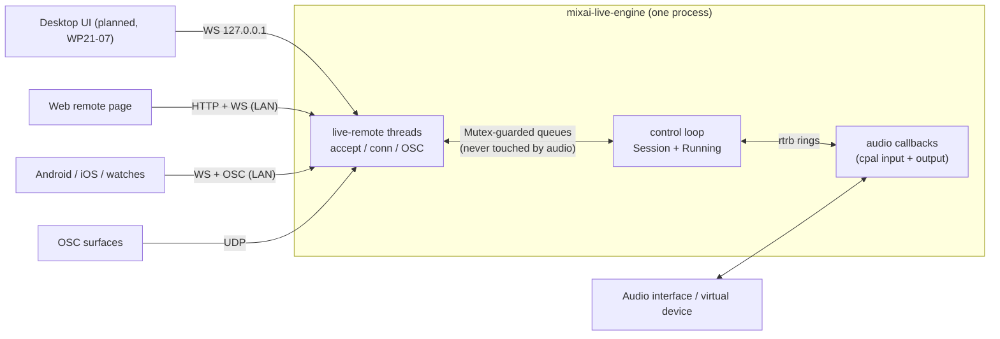
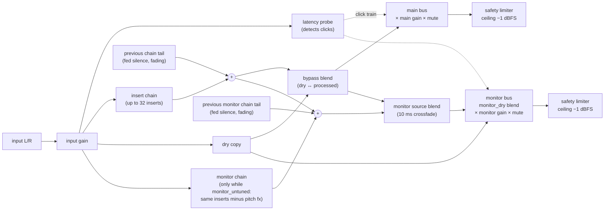
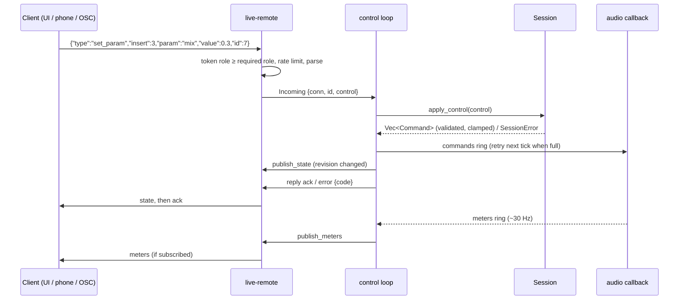

# MixAI Live — architecture

How the engine is put together, as implemented in `apps/live/engine` (crates `live-dsp`, `live-engine`,
`live-remote`, `live-cli`). Decisions and rationale: [ADR-0015](../adr/0015-mixai-live-performance.md).

## Process model

The engine is **its own process** (`mixai-live-engine`). Everything that is not audio — the desktop UI, phones,
watches, the web remote page, OSC surfaces — is a client of the same local/LAN control protocol, so the engine
runs identically on a headless stage PC and behind the desktop app.

- `serve` binds `127.0.0.1` by default (desktop UI on the same machine); `--lan` binds `0.0.0.0` and announces
  `_mixai-live._tcp` over mDNS. Details: [remote protocol](remote-protocol.md).
- `run`, `latency` and `render` use the same engine without the control server ([CLI](cli.md)).
- Planned: plugin instances in sandbox worker processes ([plugins](plugins.md)) and a voice-conversion stage
  ([voice conversion](voice-conversion.md)); neither exists yet.

## Threads

| Thread | Owner | Does |
|---|---|---|
| cpal input callback | `live-engine::io` | copies the selected input channels (mono → L=R) into the input ring |
| cpal output callback | `live-engine::io` | drains commands, pulls input, runs `Core::render`, writes buses, pushes meters/garbage |
| control loop (main) | `live-cli` | every 5 ms: drains remote controls → `Session` → commands; publishes state + meters; drops garbage |
| `live-remote-accept` | `live-remote` | accepts TCP connections (HTTP + WebSocket upgrade) |
| `live-remote-conn` (one per client) | `live-remote` | auth, rate limit, parse, queue controls, send state/meters/replies |
| `live-remote-osc` (only with OSC on) | `live-remote` | OSC/UDP; each address is checked against the OSC keys |

Processing happens in the **output** callback, so the in → out path is one input period + the ring target
(one block) + one output period. Input and output may be different devices; clock drift is handled by
dropping the oldest input frames when the ring overfills (`RunningInfo.notes` says so).

## Audio-thread rules

The output callback and everything it calls (`Core`, `Chain`, every `Processor`) follow hard rules:

1. **No allocation, no deallocation.** Effects, inserts and chains are built on the control thread (boxed) and
   moved in through a command. Anything removed — an old chain after a preset change, a removed insert, a
   finished reverb tail — is **sent back** through the garbage ring and dropped on the control thread
   (`Running::poll`). Tests run the full chain and `Core::render` (including a chain swap) under
   `assert_no_alloc`.
2. **No locks.** Three single-producer/single-consumer `rtrb` rings connect the threads; a full ring never
   blocks (the control loop retries a command next tick; meters/garbage pushes are best-effort).
3. **No unbounded work.** Fixed-size buffers sized at construction (`max_block` = max(8 × buffer, 2048) frames
   in device mode), fixed-size arrays for the latency median, tails processed in 256-frame chunks.
4. **Every gain change is ramped** (`Smoothed`: 10 ms for bypass, mute, monitor-dry and for bus gains going
   down, 300 ms for bus gains going up; per-effect smoothing inside processors).
5. **Errors are classified.** Driver xruns and a refused realtime priority are counted/logged; any other stream
   error marks the stream dead and the control loop exits with the driver message.
6. **Input is sanitised.** Non-finite input samples are replaced by silence before the chain, so one bad sample
  from a driver cannot poison an envelope follower.
7. **Flush-to-zero while rendering.** `Core::render` switches the CPU to flush-to-zero for the block
   (`live_dsp::NoDenormals`: MXCSR FTZ + DAZ on x86-64, FPCR.FZ on AArch64, no-op elsewhere) and restores the
   previous mode on return, so the host's own code (a driver callback, a phone app) is not affected. Without it,
   states decaying into digital silence park in the subnormal range and every operation on them runs in
   microcode: measured with `render` on a file that goes silent, 11–27× the CPU of the same file with −120 dB
   of noise; with it, the same (0.7–1.0×).

| Ring | Direction | Capacity | Payload |
|---|---|---|---|
| commands | control → audio | 1024 | `Command` (set param, enable, add/remove/move insert, swap chain, gains, bypass, mute, probe, reset) |
| garbage | audio → control | 256 | `Garbage::Chain` / `Garbage::Insert` boxes to free |
| meters | audio → control | 64 | `Meters` snapshot (`Copy`, no heap) |
| input | input cb → output cb | ~170 ms of stereo frames | interleaved `f32` L/R |

Underruns (ring short of a full block once primed) count as engine `xruns`, separately from driver xruns.

## Core and buses

`live_engine::Core` is device-independent (also used by `render` and the tests). Per block:

- **main** — FOH / stream / recording, routed to `--main` (default channels `0,1`).
- **monitor** — the performer's in-ear mix, routed to `--monitor` (optional). `monitor_dry` 0 = processed only,
  1 = dry only; the singer can keep a dry reference while the audience hears the full chain.
- **monitor chain** (`monitor_untuned`, "tuned only for the audience") — an optional second chain that feeds the
  monitor bus: the same inserts, parameters, order and enabled flags as the main chain, minus the pitch effects
  (`autotune`, `harmonizer`), so the ears do not pay the shifter's 256 samples (5.3 ms) while the main bus keeps
  the full chain. It is built and edited on the control thread, charges nothing while the option is off, and its
  effects have their own state (its reverb is not the main chain's reverb). A 10 ms crossfade moves the monitor
  bus between the two sources; a scene change gives the monitor its own tail, so the ears get no click and no
  reverb cut that the audience does not get.
  Measured on the simulated device (2026-11-13, release binary, `Pop Polish`, the engine's own CPU time per
  second of audio, so the reading does not depend on what else the machine is doing): **5.3 % of one core with
  the option off, 5.6 % with it on** — one more chain costs about 0.03 s of CPU per 10 s of audio. The
  simulated device processes silence, so both figures are a floor and the difference is a lower bound; a voice
  makes both chains do more work per sample.
- `bypass` blends every bus to the dry input (instant safe mode); `mute` silences every bus; both ramp 10 ms.
- The **safety limiter** is the last stage of each bus and is not an insert: nothing can remove or disable it,
  and bypass, the dry monitor blend and the latency click go through it. Zero latency, stereo-linked, instant
  attack, 120 ms release, exact ceiling at −1 dBFS; it reports its gain reduction in the meters (`safety_gr`).
  It is a sample-peak limiter, not a true-peak one: a look-ahead true-peak master for the stream bus is planned.
- `panic` (remote) = mute + `Reset` (clears every delay line, reverb tail and envelope).
- Planned: per-musician in-ear mixes (WP21-13) and a converted-voice FOH bus (WP21-11).

## Scene swap with tail spill

Loading a preset (directly, or by navigating a setlist) builds a new chain on the control thread and sends
`SwapChain` — or `SwapChains { chain, monitor }` while `monitor_untuned` is on, which carries both chains in one
command so the ears change scene in the same sample as the audience. The audio thread swaps pointers and keeps
the **old chain** as a tail (and the old monitor chain as its own tail on the monitor bus):

1. Tail length = old chain `tail_seconds()` (max over enabled inserts: reverb `decay + pre_delay`, delay echoes
   to −60 dB, chorus/doubler ~50–60 ms), capped at 6 s. Zero → the old chain goes straight to garbage.
2. While the tail is active it is fed silence and mixed under the new chain, with a linear fade over the tail.
3. When the tail ends, `take_finished_tail` hands the box to the garbage ring. A second swap during a tail drops
   the older tail immediately.

The test `scene_swap_is_click_free_and_rings_out` switches from "Ballad Hall" to "Speech / MC" mid-note and
asserts no sample step above 0.25 and that the hall tail is still ringing 1 s later.

## Meters

`Core::meters_due` publishes a `Meters` snapshot every `sample_rate / 30` samples (~30 Hz; with 128-frame
blocks the interval rounds up to whole blocks, ≈ 29 Hz): input peak/RMS, output peak/RMS per channel, gain
reduction per insert, pitch status of the first enabled pitch insert, DSP load (EWMA and max of callback time ÷
buffer time), engine xruns, the safety stage's deepest gain reduction per bus (`safety_gr`, dB), the clip flag
(true when that reduction is above 0.1 dB: the signal after the faders was too hot, the output itself did not
clip), latency-probe state and chain latency. The control loop keeps only the newest snapshot and publishes it
to subscribed clients (`meters`, 1–30 Hz per client).

## Control flow

Every controller speaks one vocabulary, `live_engine::Control` (serde form = the client messages of the
[remote protocol](remote-protocol.md)). The control thread owns a `Session` — a mirror of the audio state
(chain with insert ids and parameter values, mix, presets, setlist, position, BPM, revision) — so clients read
state without touching the audio thread.

- `Session` validates ids and clamps values against the `ParamSpec` table before a command exists; the audio
  thread never sees an invalid index.
- State is published before acks, so a client that receives `ack` already holds the new state.
- `Role`: `viewer` < `performer` < `controller`. Performers may load presets, navigate the setlist, change the
  mix, tap tempo and panic; everything else needs `controller` (`Control::required_role`).
- Song recall: `goto`/`next`/`prev` loads the part's preset, applies the song `key` to every `autotune`/
  `harmonizer` insert and the song `bpm` to every `delay` insert. Tap tempo averages 2–8 taps (reset after 2 s
  idle) and sets `bpm` on every delay.

## Engine host

`live_remote::EngineHost` owns the streams, the `Session` and the `RemoteServer` on one control thread (5 ms
tick: retry queued commands, drain remote + in-process controls, MIDI, publish state then acks, meters, stream
health). `mixai-live-engine serve` and the phone engine (`live-ffi`) both run it, so every surface behaves the
same. The streams are opened inside that thread and never cross threads. `io::start` with host `Null` is a
simulated loopback device for tests.

## Crate map

| Crate | Licence | Depends on | Role |
|---|---|---|---|
| `live-dsp` | MIT OR Apache-2.0 | — (zero runtime deps) | `Processor` trait, 13 effects, `Chain`, `Insert`, `ParamSpec`, `Smoothed` |
| `live-engine` | MIT OR Apache-2.0 | `live-dsp`, cpal 0.18, rtrb, serde | `Core`, `Command`, `Meters`, device I/O, presets/setlists, `Session`, `Control`, latency probe |
| `live-remote` | MIT OR Apache-2.0 | `live-engine`, tungstenite (handshake), rosc, mdns-sd, qrcode | HTTP + WebSocket server, OSC, mDNS, QR, web remote page |
| `live-cli` | MIT OR Apache-2.0 | all of the above, clap | `mixai-live-engine` binary |
| `live-ffi` | MIT OR Apache-2.0 | `live-engine`, `live-remote`, uniffi 0.32 | Phone engine for Kotlin/Swift ([ffi](ffi.md)) |
| `live-host`, `live-vc` | — | — | planned (WP21-10, WP21-11) |
