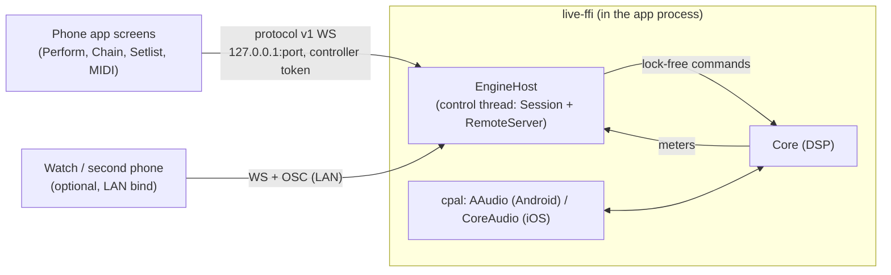

# MixAI Live — phone engine (`live-ffi`)

The phone or tablet can run the **same engine** as the desktop sidecar, as a backup processor when no computer
is around (tracker WP21-06, [ADR-0015](../adr/0015-mixai-live-performance.md)). Nothing is re-implemented:
`live-ffi` wraps `live-engine` (device I/O, realtime core, presets, setlists, MIDI map store) and the protocol v1
server from `live-remote`, and exposes them to Kotlin and Swift through UniFFI 0.32.

The app's existing WebSocket client connects to the in-process engine exactly as it connects to a PC, so every
screen works unchanged. Only the start/stop/latency controls are FFI calls.

## API (UniFFI, proc-macro)

| Item | What it does |
|---|---|
| `LiveEngine.start(LocalEngineConfig)` | Opens the audio devices, loads the preset, starts the control server. Throws `LiveError.Audio` (no mic permission, device busy, no f32 format) or `InvalidArgument`. |
| `LiveEngine.ready() -> EngineReady` | `local_host` (always 127.0.0.1), `lan_host`, `port`, `controller_token`, pairing URLs, device names, rate, buffer, nominal latency, warnings. |
| `LiveEngine.state_json()` | Current `SessionState` (the protocol's `state.state`). |
| `LiveEngine.meters()` | Peak/RMS, DSP load, xruns (engine + driver), tuner pitch, latency-probe state. |
| `LiveEngine.control_json(json)` | Any protocol v1 client control applied in-process. Errors: `LiveError.Control { code, reason }`. |
| `set_mute`, `load_preset`, `panic` | Shortcuts for the common controls. |
| `LiveEngine.measure_latency(timeout_ms)` | Click-train round trip (median of 5), blocking. Needs a loopback: speaker → mic or a cable. |
| `LiveEngine.stop()` | Releases the devices and closes the server. Idempotent. |
| `live_hosts()`, `live_devices(host)`, `live_factory_presets()`, `live_protocol_version()`, `live_version()` | Helpers. |

`LocalEngineConfig` defaults for phones: 48 kHz, 192-frame callbacks, `Natural Vocal`, loopback bind,
**`start_muted = true`** (a phone speaker next to its own microphone howls), memory-only unless `data_dir` is set.
`lan = true` binds every interface and announces `_mixai-live._tcp` over mDNS; the Android card shows a QR with the
performer link, and the watch gets the LAN endpoint + performer token. OSC stays off on phones (it trusts loopback
packets without a token, so any app on the phone could drive the mix).

Conventions match `decks-ffi`: polling instead of callbacks, one `Mutex` per object, the audio callback stays on
cpal's thread, and every error has a `reason` field (never `message`: Kotlin's `Throwable.message` owns that name).

### The "Null" host

`audio_host = "Null"` selects a simulated device: one thread ticks every buffer period in real time and feeds the
main output back into the input (a perfect loopback cable). Rust tests, the Kotlin JVM tests and CI use it; the
latency probe measures 1–4 blocks on it, which proves the probe end to end without hardware.

## Android

- Gradle module `:live-ffi` (`apps/live-android/ffi`): cargo-ndk builds `live-ffi` into jniLibs (API 26, arm64-v8a +
  x86_64; `-Pmixai.rustAbis.debug=arm64-v8a` for fast phone builds), UniFFI generates `ro.mixai.live.ffi` from the
  host library. With `target_os = "android"` the crate enables cpal `realtime` = AAudio `PerformanceMode::LowLatency`
  + audio thread priority; AAudio picks MMAP (exclusive) when the device allows it.
- `LiveAndroid.init(context)` hands the JavaVM + Context to cpal (`ndk-context`) before the first start.
- `LocalEngine` (Kotlin) wraps the generated object: `Result` instead of exceptions, safe after `stop()`, and a
  `paired: PairedEngine` (127.0.0.1, controller) for the app's `LiveClient`.
- App: the Connect screen has a **This phone as the engine** card (mic + notification permission, optional LAN
  control, Open / Measure latency / Stop). A `microphone` foreground service keeps the process alive with the
  screen off; swiping the app away stops the engine. The phone engine is never saved as a paired engine.
- Tests: `:live-ffi:testDebugUnitTest` loads the host `live_ffi.dll/.so/.dylib` (`jna.library.path`) and drives the
  engine with the real `:live-core` `LiveClient` over 127.0.0.1 on the Null host.

## iOS / iPadOS

- Swift package `apps/ios/LiveFFI`: `scripts/build-live-xcframework.sh ios` builds the staticlib for device +
  simulator and writes `LiveFFI.xcframework` + `Sources/LiveFFI/LiveFFI.swift` (both gitignored). Without the
  xcframework the package still resolves and LiveApp shows the card disabled (`LiveFFIPackage.hasEngine`).
- `LocalEngine.swift`: microphone permission, `AVAudioSession` `.playAndRecord` / `.measurement`, 48 kHz, 4 ms IO
  buffer, engine start off the main actor, then `LiveSession.connectLocal` (token kept in memory only).
- `UIBackgroundModes: audio` keeps processing with the screen locked; `NSMicrophoneUsageDescription` states that
  audio never leaves the device.

## Measured

| Device | Build | Path | Buffer | Round trip | DSP |
|---|---|---|---|---|---|
| Galaxy S25 Ultra (SM-S938B, Android 16) | benchmark (release Rust, R8) | built-in speaker → built-in mic, AAudio exclusive MMAP (burst 96/48) | 192 @ 48 kHz (nominal 12 ms) | **52.9–55.7 ms** over 3 sessions (debug build 53.9 ms) | Natural Vocal ~0–10 % |
| Galaxy A51 (SM-A515F) | benchmark | AAudio exclusive MMAP | 192 @ 48 kHz | not measured (see below) | Natural Vocal 5 % (debug build 45 % with 35 dropouts) |
| Null host (CI) | debug | simulated cable | 64 @ 48 kHz | 1.3–5.3 ms (1–4 blocks) | — |

The acoustic figure includes the speaker and microphone DSP chains of the phone (Samsung applies its own
processing to the built-in mic and speaker); the engine's own share is the nominal 12 ms. Wired headphones or a
USB audio interface give lower figures; measure with a cable from the output to the input for the engine-only
number. Stopping right after starting does not crash the foreground service (S25, logcat crash buffer empty). The A51 latency run was blocked by a Samsung/Google sign-in prompt covering the screen during the test
session; the engine itself started, held the exclusive MMAP endpoints and ran at 5 % DSP.

Debug builds of the Rust code are not representative on phones (A51: 45 % DSP and dropouts vs 5 % release). Measure
with `:live:assembleBenchmark`.
