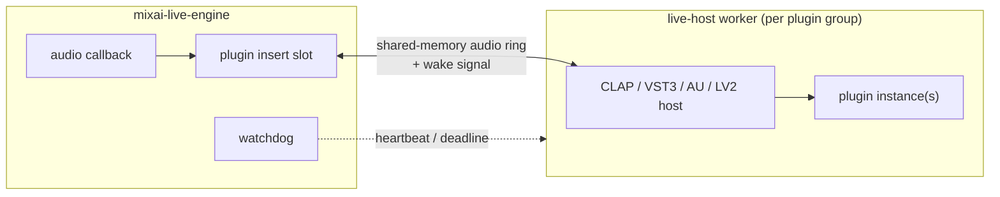

# MixAI Live — plugin host (design)

> **Status: planned (WP21-10).** Nothing on this page is implemented yet. It records the design agreed in
> [ADR-0015](../adr/0015-mixai-live-performance.md) (decision 2, `live-host`) and the research of 2026-11-09
> in tracker [§14](../mixai-design-tracker.md#14-mixai-live--realtime-vocal-processor--controllers-adr-0015-2026-11-09).

## Goal

Let singers use the plugins they already own (vocal tuners, channel strips, reverbs) as inserts in the same
chain as the built-in [effects](effects.md), without a crashing or misbehaving plugin taking the show down.

## Formats

| Format | Platforms | Library / SDK | Licence note |
|---|---|---|---|
| CLAP | Windows, macOS, Linux | `clack-host` 0.2.0 | MIT/Apache |
| VST3 | Windows, macOS, Linux | Steinberg VST3 SDK (Rust bindings `vst3` 0.3.0) | SDK is **MIT since 2025-10-20** — no proprietary agreement needed |
| AU (Audio Unit v2/v3) | macOS | AudioToolbox | system framework |
| LV2 | Linux | lilv | ISC |

VST2 is not supported (SDK withdrawn by Steinberg).

## Sandbox

Every plugin group runs in a **separate worker process**; the engine process never loads plugin code.

- **Shared-memory audio**: the insert slot writes its input block into a shared ring, wakes the worker and
  reads the processed block back within the callback deadline. No sockets or pipes on the audio path.
- **Deadline**: if the worker misses the block deadline the slot outputs the dry signal for that block (counted
  as a plugin xrun) — the chain never waits.
- **Watchdog**: a crashed or hung worker is detected (process exit, missed heartbeats); its slot is **bypassed**
  click-free (the existing `Insert` crossfade), the UI shows the failure, and the worker restarts with the last
  known plugin state.
- **Grouping**: plugins can share a worker to save context switches; a plugin that crashed once is isolated in
  its own worker.
- The added latency (one extra block when a worker processes asynchronously, plus the plugin's reported
  latency) is included in the chain latency and the measured round trip.

## State and scanning

- Plugin state (opaque chunk, base64) is stored in presets next to built-in inserts, so a song part recalls a
  plugin setting like any other insert. The preset format change will be versioned (format v2) when it lands
  ([presets](presets.md)).
- Plugin scanning also runs in a worker; results are cached by path + modification time + format; plugins that
  crash during the scan are blacklisted until rescanned.
- Parameters are exposed to controllers through the same `set_param` / `set_param_norm` messages
  ([remote protocol](remote-protocol.md)) using the plugin's parameter ids.

## Product

The sandboxed plugin host is a **Pro** feature (`live_pro`, ADR-0015 decision 9).
