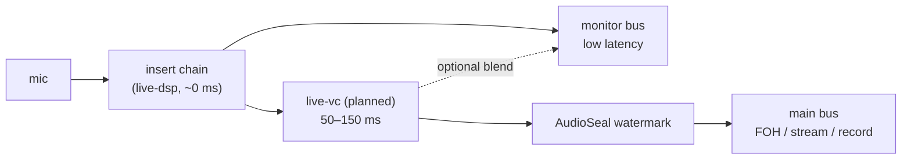

# MixAI Live — realtime voice conversion (design)

> **Status: planned (WP21-11).** Nothing on this page is implemented yet. It records the design agreed in
> [ADR-0015](../adr/0015-mixai-live-performance.md) (decision 2, 3, 7, 9) and the research of 2026-11-09 in
> tracker [§14](../mixai-design-tracker.md#14-mixai-live--realtime-vocal-processor--controllers-adr-0015-2026-11-09).
> Figures are from published projects, not measured in MixAI Live.

## Goal

Two use cases, both live and natural-sounding (not robotic):

1. **Own voice when hoarse** — a singer trains a model on their own healthy recordings and sings through it
   when the voice is tired or ill.
2. **Consented timbre** — a voice from the official library, recorded with written consent from the voice
   owner (phase 1). An open marketplace with KYC and revenue share is a separate work package (WP21-16).

## Two model tiers

| Tier | Model family | Hardware | Algorithmic latency (published) | Use |
|---|---|---|---|---|
| Low-latency | Beatrice-2-style (trainer MIT) | 1 CPU thread | ~50 ms, singing-capable | default, laptops, stage PCs without a GPU |
| Quality | RVC v2 format / Applio-trained models | GPU (DirectML, CUDA, CoreML) | ~80–150 ms | studio-like timbre when a GPU is present |

Both run in a planned crate `live-vc` over ONNX Runtime (`ort` 2, execution providers DirectML / CUDA / CoreML /
CPU). Rejected: Seed-VC (GPL, archived). Watched: MeanVC (Apache, zero-shot, research stage).

## Monitor / FOH split

50–150 ms is far too late for the singer's own ear (the in-ear target is ≤ 6 ms). So conversion never sits on
the monitor path by default:

- **Monitor**: the processed natural voice, with an optional dry/converted blend so the singer can hear roughly
  what the audience hears without losing timing.
- **Main (FOH / stream / record)**: the converted voice. Backing tracks or a click sent to the band can be
  delayed by the same amount (planned with WP21-13) so the audience hears everything aligned.
- The engine reports the conversion latency next to the chain latency, measured, not assumed.

## Watermark and labelling

- Every converted output carries an **AudioSeal** watermark (MIT, weights included) embedded before it leaves
  the engine — FOH, stream and recordings.
- **EU AI Act art. 50** (synthetic audio marking, applicable from 2026-08-02): converted audio is machine-
  readably marked (the watermark) and the app shows a visible "AI voice" label while conversion is on, with a
  setting to announce it on stream overlays and in recording metadata.
- The watermark and label cannot be switched off for third-party voices.

## Consent

- **Own voice**: the training flow records a short spoken consent phrase in the same session as the training
  data and stores a consent record (who, when, which model, hash of the training set) with the model.
- **Official library**: written consent from each voice owner, scope (live, stream, recording), revocation
  terms; the model package carries the consent id.
- **Marketplace (WP21-16)**: KYC, consent phrase, speaker-similarity check between the consent recording and the
  training data, revenue share through Brivio payments.
- Converting **to** a voice without a consent record is not offered.

## Own-voice training flow

1. Guided recording in the desktop app: 10–30 minutes of healthy singing and speech across the singer's range,
   with level and noise checks (reusing the engine meters).
2. Consent phrase recorded and stored (above).
3. Local training on the user's machine (GPU if present; CPU fallback for the Beatrice-style tier) — recordings
   never leave the device unless the user exports them.
4. Export to ONNX, quick A/B test against a held-out phrase, then the model becomes a chain-level option.

## Product

Voice conversion is a **Pro** feature (`live_pro` entitlement in `apps/web/src/lib/entitlements.ts`, default
off). Privacy: microphone audio is processed on the device; the privacy policy update ships with the feature
(WP21-15).

## Open questions (to settle when WP21-11 starts)

- Exact Beatrice-2 model export path to ONNX and its real CPU cost at 48 kHz inside the engine budget.
- Where the conversion runs: a dedicated thread fed by a ring (most likely, so the audio callback never waits)
  or a worker process like the plugin sandbox.
- Pitch handling: run conversion before or after `autotune` (likely before; correction on the converted voice).
